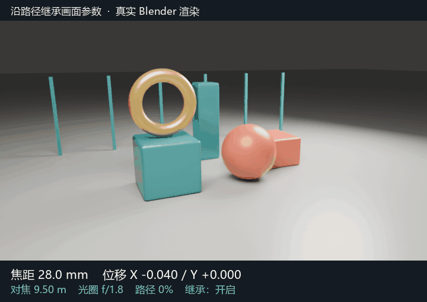

# Camera Helper 修改版

快速创建、切换和预览相机，让运动相机沿路径继承画面参数。

**[下载可安装 ZIP](https://github.com/shuanghenyanshang/CameraHelper-Modified/releases/download/v1.4.2-motion-inherit-r2-20261114/CameraHelper-1.4.2-motion-inherit-R2.zip)** · [更多更新与演示](https://github.com/shuanghenyanshang/CameraHelper-Modified/releases/tag/v1.4.2-motion-inherit-r2-20261114)

下载后在 Blender 扩展菜单选择“从磁盘安装”，启用 **Camera Helper**。

## 日常使用

- **创建相机**：点击创建按钮，保留当前取景和输出设置。
- **运动路径**：Ctrl 点击创建按钮，按顺序选择来源相机，右键结束。
- **画面参数继承**：在 **Controller → MotionCamera → 调整** 中启停。默认沿路径继承焦距、镜头位移和景深，关闭后保留当前值，可手动调整。
- **切换与预览**：通过相机按钮切换取景，或开启缩略图预览。

上游基础演示：创建相机 → 运动路径 → 修改器调整

以下三张演示来自 [上游 README](https://github.com/AIGODLIKE/CameraHelper)。

创建相机：

Ctrl 按序创建运动路径：

修改器调整：

## 来源与协议

基于 **[AIGODLIKE/CameraHelper](https://github.com/AIGODLIKE/CameraHelper)**，原作者 **ACGGIT、Atticus、小萌新**。本仓库为本地修改版，沿用 **[GPL-3.0-or-later](LICENSE)**；来源与修改范围见 [NOTICE](NOTICE.md)。
